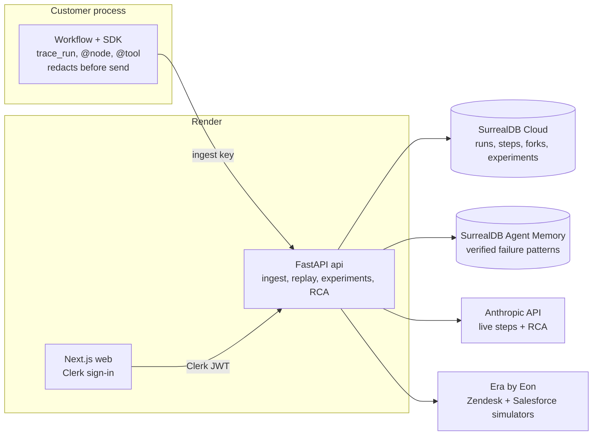

# AgentTrace

**A debugger for multi-agent LLM workflows that tests which step broke a run, and measures whether the fix works.**

Traces show what happened. AgentTrace tests what caused it: record a run, fork it at any step, edit that step, and re-run the rest live N times in a **control arm** (no edit) and a **treatment arm** (your edit). The result is a success rate per arm, checked by code against ground truth, with a Fisher exact p-value labelled *directional*.

- Live demo (no sign-in): <https://agenttrace-web.onrender.com/demo>, with an Examples dropdown: the saved failing run, all runs by time, keys and alerts, forking your own agents through a worker, and the terminal and CI
- API: <https://agenttrace-api-apaa.onrender.com/health>
- Built for Build North (Oct 2026), solo.

## What it shows

The demo workflow is a four-agent **renewal risk brief** (planner → researcher → writer ⇄ critic) over a simulated company's Zendesk and Salesforce data. A teammate "reduced noise" in the planner's prompt, so the planner filters tickets to `solved` only. Every later agent behaves sensibly given that plan, and the brief reports **0 open tickets**. The failure is planted at the first step and only surfaces at the end.

| What we did | Control | Treatment | Fisher p | Notes |
| --- | --- | --- | --- | --- |
| **Decoy:** make the critic stricter (fork at the critic) | 0/5 | 0/5 | 1.0 | The obvious fix does nothing: the data never contained open tickets. |
| **Hero:** fix the planner's ticket filter (fork at the planner) | 0/8 | 8/8 | 0.00016 | Same fork point both arms; only the edit differs. 62,722 tokens. |
| **Root-cause agent** | | | | Ranked the planner #1 (confidence 0.80). A small test (N=3 each way) supported it: 0/3 → 3/3. That is too few runs to be sure. |
| **Generalization benchmark:** original vs patched planner prompt, 5 other Era accounts, 3 fresh end-to-end runs each | 0/15 | 13/15 | | Two patched runs crashed and count as not passing. |

These are the stored results behind the `/demo` page, not mock-ups. N is small, so every figure is **directional evidence**, not proof.

## How replay works

**Recorded steps replay exactly. Forked steps re-run live.** AgentTrace never calls the live part deterministic; it measures it.

| Segment | Source | Tokens |
| --- | --- | --- |
| Steps before the fork | Read back from the recording (no model or tool calls) | 0 |
| The edited step | Your edited output replaces the recorded one | 0 |
| Steps after the fork | Re-run live against Claude and the data source, sampled | live |

State at the fork is the recorded state after the previous step, overlaid with your edit. Nodes are pure functions of `(state, llm, tools)` and declare which state keys they read and write, which is how the root-cause agent follows data from the symptom back to its source. A model-pin check refuses to run an experiment if the recorded model is unavailable, and tools that declare a side effect cannot run live in a fork without a registered mock.

Why a control arm: one replay with a fix that "works" could be luck, because live steps are sampled. Running the same fork point with and without the edit, N times each, is what turns a replay into evidence. Why a code oracle: success is checked in code against exact ground truth from the data source, so a pass is not an LLM's opinion.

## Architecture



- `sdk/` stdlib-only recorder: `trace_run`, `@node`, `@tool`, `TracedLLM`, redaction, `HttpSink`.
- `api/` FastAPI service: ingest, read API, replay engine ([fork.py](api/app/replay/fork.py)), experiment runner and statistics ([experiments/](api/app/experiments)), root-cause agent ([rca/](api/app/rca)), security ([security/](api/app/security)), workflow and oracle ([workflows/renewal_brief](api/app/workflows/renewal_brief)).
- `web/` Next.js (App Router) UI: a run is a workbench. The answer and a scoreboard at the top, the run drawn as one continuous line of agents with every fork opening a new branch under it, and, for the agent you select, what went in, what came out and what it passed on, beside an editor where you change it and fork. A dashed new line appears on the graph as soon as you change a value. The Runs page is a Gantt: one numbered row per run (oldest first, grouped by workflow, each run in its own colour) with time across, and every fork a marker on the row under its run. Filters: All, Wrong, Fixed, Right. Plus the public `/demo`.
- Experiments run as asyncio tasks inside the API process, 3 at a time.

## Root-cause agent

Claude Haiku 5.5 reads a compacted trace (full detail only for steps on the data-lineage path to the failing oracle field), recalls similar verified patterns from Agent Memory, and must answer with a forced `report_candidates` tool call: up to 3 candidates with confidence, hypothesis, evidence quotes and a small proposed edit. Evidence quotes are checked verbatim against the trace. **The agent proposes; experiments decide.** "Verify" runs the top two candidates that carry a concrete edit at N=3 per arm and re-ranks them by measured improvement. Trace content is untrusted input: it is delimited, the agent has no tool that acts on anything, and its output is schema-validated.

## Partner platforms

| Platform | How it is used | Where to look |
| --- | --- | --- |
| **Anthropic** | Demo agents and the root-cause agent on `claude-haiku-5-5`; forced tool call with schema validation; effort (not temperature) is the sampling control, because Haiku 5.5 rejects non-default temperature. | [rca/agent.py](api/app/rca/agent.py), [config.py](api/app/config.py) |
| **SurrealDB** | Trace store with graph edges (`has_step`, `next`, `forked_from`, `tested`) in SurrealDB Cloud. **Agent Memory** `remember`s a redacted paragraph for each *verified* root cause, `recall`s it into the next analysis ("seen before" chip with the source run and experiment), and `forget`s it exactly when a run is deleted. | [schema.surql](api/schema.surql), [rca/memory.py](api/app/rca/memory.py) |
| **Clerk** | Sign-in and organizations as workspaces, admin vs member roles. The API verifies the session JWT (RS256, JWKS, issuer, expiry, authorized party) and takes the workspace **only** from the token's organization. | [auth.py](api/app/auth.py), [proxy.ts](web/proxy.ts), [test_auth.py](api/tests/test_auth.py) (cross-org isolation) |
| **Era by Eon** | The simulated company (Zendesk + Salesforce) is the workflow's tool environment and the source of exact ground truth for the oracle. The benchmark runs the original and patched workflow on five other Era accounts. | [tools.py](api/app/workflows/renewal_brief/tools.py), [oracle.py](api/app/workflows/renewal_brief/oracle.py), [benchmark.py](api/app/benchmark.py) |
| **Render** | `web` and `api` services from one Blueprint. | [render.yaml](render.yaml) |

## Quickstart

Needs Python 3.11 and Node 20+. The offline test suites need no keys.

```bash
git clone <this repo> && cd AgentTrace
cp .env.example .env            # names only; fill in the values you have

# API (offline tests: fake database and fake model)
cd api && python3.11 -m venv .venv && .venv/bin/pip install -e ../sdk -e '.[dev]'
.venv/bin/pytest                # 231 passed, 13 live tests skipped
cd ..

# SDK (stdlib only)
api/.venv/bin/pytest sdk/              # 68 passed

# Web
cd web && npm install && npm test && npm run build   # 38 passed
```

To run it for real you need a SurrealDB Cloud instance, an Anthropic key and (for the full demo) Clerk keys, an Era company and an Agent Memory context. `api/scripts/check_env.py --phase N` lists what is still missing. Without Era, set `TOOLS_BACKEND=fixtures` to use `fixtures/company.json`.

```bash
cd api && .venv/bin/uvicorn app.main:app --reload     # http://localhost:8000
cd web && npm run dev                                  # http://localhost:3000
```

Useful scripts (`api/scripts/`): `seed_demo.py` (record the failing run, run the decoy and hero experiments, store the root-cause report), `era_benchmark.py`, `verify_demo.py`, `remember_experiment.py`, `create_workspace_key.py` (mint an ingest key, shown once). Live tests: `RUN_LIVE=1 .venv/bin/pytest`.

Connecting your own agents: sign in, create an organization, then open **Connect your agents**. There you can add the saved example to your workspace (a real run you can fork at once, no code, no tokens), make a key and copy the snippet, or import past logs (those are view only). Agents you did not write can be recorded too, from OpenTelemetry GenAI traces or a LangGraph stream, and given a right or wrong verdict by a check you write (forkable through a worker you run next to your code); an assistant or the command line can look at failed runs through MCP: see [docs/integrations.md](docs/integrations.md) (which also covers failure alerts to Slack and a CI gate) and [docs/self-host.md](docs/self-host.md) to run it yourself. See [sdk/agenttrace_sdk](sdk/agenttrace_sdk) and [record_demo.py](api/scripts/record_demo.py) for a complete example.

Recording your own workflow in code:

```python
from agenttrace_sdk import trace_run, node, tool, TracedLLM, HttpSink
```

See [sdk/agenttrace_sdk](sdk/agenttrace_sdk) and [record_demo.py](api/scripts/record_demo.py) for a complete example.

## Security

Redaction at the source and again on ingest (`[REDACTED:<type>:<hash8>]`), 32 KB field limit, workspace isolation from the verified identity only, admin-only run deletion that cascades into forks, experiments, reports and Agent Memory, an audit log, spend limits (N per arm, token ceiling, daily cap per user, per-minute rate limits), and an untrusted-input design for the root-cause agent. Details, and what is **not** covered, are in [SECURITY.md](SECURITY.md). A `gitleaks` scan of the working tree and history is clean.

## Limitations

- **N is small.** Results are directional. The UI says so and shows Wilson intervals.
- **Only registered workflows replay.** There is no endpoint that runs arbitrary code, and the recorder currently targets Python and the Anthropic SDK.
- **Edit-output mode only.** You can replace a step's output; editing a prompt and re-running that step live is not built.
- **Experiments live in the API process** and are lost on a restart; the UI polls (no streaming).
- **Rate limits are per process**, and there is no retention sweep or key-rotation endpoint (see SECURITY.md).
- **Auto-verify tests only candidates with a concrete edit.** On the demo run that was one of three.
- **The benchmark is one workflow** on five accounts; two patched runs crashed and their cause was not recorded.
- The demo uses an Era tenant token that expires and is refreshed by hand.

## Related work

- [Rewind](https://github.com/agentoptics/rewind) forks a session at a step, serves earlier steps from cache and re-runs the changed step live. It has an LLM-driven `rewind fix` diagnosis, evaluators including an LLM judge, datasets and side-by-side experiment comparison.
- [LangGraph time travel](https://docs.langchain.com/oss/python/langgraph/use-time-travel) replays from a checkpoint or forks it with modified state; nodes after the checkpoint re-execute.
- Tracing platforms such as LangSmith, Langfuse and Phoenix record and display runs.

AgentTrace is meant to complement these. What it adds: **control-arm experiments** (N live suffixes with and without the edit, with uncertainty), **root cause ranked by measured effect**, a **code oracle on exact ground truth** instead of a judge, and **shared failure memory** for verified causes. It is a hackathon MVP, not a replacement for a production tracing stack.

## Built with

Python 3.11, FastAPI, Pydantic v2, the Anthropic SDK, SurrealDB Cloud and Agent Memory (`surrealdb-memory`), Next.js 16, Clerk, Tailwind, Render, and Era by Eon. The web app started from `create-next-app` and the Clerk quickstart. No LangChain or LangGraph.

## License

MIT, see [LICENSE](LICENSE). The planning documents are in [docs/](docs).
